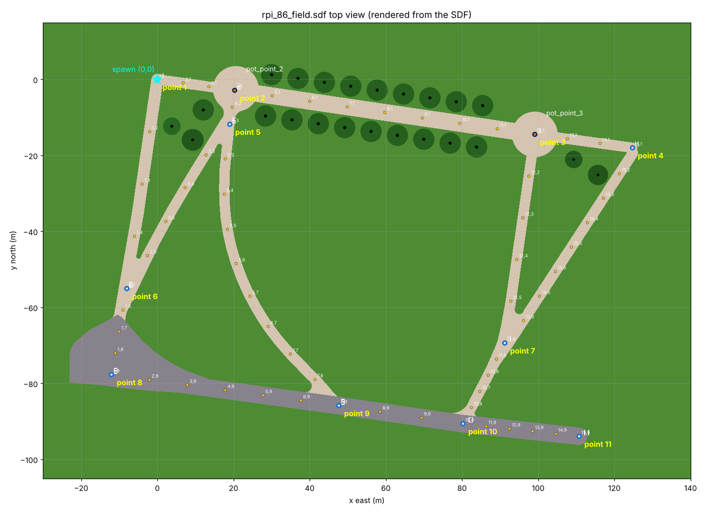
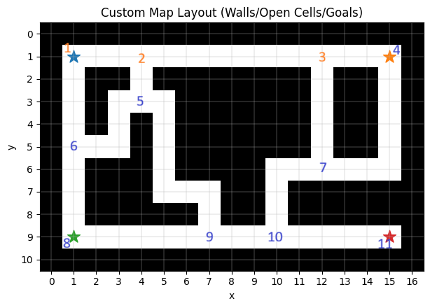

## Transformer interface (Jetson, stages 0–1 and 3–4)

The isolated ROS/GPU interface is in `src/husky_transformer_bridge` and
`src/husky_transformer_policy`. See [deployment and tests](docs/transformer/README.md)
and the [input contract](docs/transformer/CONTRACT.txt).
It does not subscribe to live odometry or issue navigation/velocity commands yet.
Transactional history and a paced, isolated ROS/GPU recorded replay are available.
Live state adaptation and calibration remain outstanding.
Weights, the GPU environment and runtime logs stay in `~/transformer_deployment`.

See the [GPS reception and NavFn/A* bench](bench/gps_navfn/README.md) for setup, rerun commands and recorded results.

## Workspace layout

| Package | What it holds |
|---|---|
| `husky_description` | Sensors Clearpath doesn't support: RPLidar S2E, u-blox ZED-X20D GNSS antennas (front + rear), simulated ZED 2i camera |
| `husky_bringup` | `robot.yaml`, Gazebo bridge config, RViz view (`sim.rviz`), launch files (`sim.launch.py`, `real.launch.py`) |
| `husky_interfaces` | Custom messages (`GridCell`, ...) |
| `husky_control`, `husky_localization`, `husky_rl` | Controller, EKF/UWB, RL pipeline (see below) |
| `husky_transformer_bridge`, `husky_transformer_policy` | Transformer interface (see above) |

Clearpath reads `~/clearpath/robot.yaml` (a link to `husky_bringup/config/robot.yaml`) and builds the
robot from it. `robot.yaml` pulls in `husky_description/urdf/husky_extras.urdf.xacro` for our sensors.

### First-time setup (new machine)

```bash
# ROS 2 Jazzy installed and sourced first: source /opt/ros/jazzy/setup.bash
git clone <this repo> ~/husky_dev
cd ~/husky_dev
rosdep install --from-paths src -yi                 # installs Clearpath packages and other deps
bash src/husky_bringup/scripts/setup_clearpath.sh   # links ~/clearpath/robot.yaml to this repo
colcon build --symlink-install
```

Add to `~/.bashrc`:

```bash
source /opt/ros/jazzy/setup.bash
source ~/clearpath_ws/install/setup.bash   # only for the modified Clearpath packages (below)
source ~/husky_dev/install/setup.bash
```

#### Modified Clearpath package (Nav2 config)

Clearpath's Nav2 config expects a SLAM map, which the open field can't provide. Until the params move
into `husky_bringup`, keep this overlay in `~/clearpath_ws/src`:

- `clearpath_nav2_demos`: odom-only Nav2 params in `config/a200/nav2.yaml` (global frames `odom`,
  no `static_layer`, `inf_is_valid: true`)

The '86 Field world no longer needs a modified Clearpath package: it lives in `husky_bringup/worlds/`,
and `sim.launch.py` adds that folder to Gazebo's search path.

```bash
cd ~/clearpath_ws && colcon build --symlink-install
```

## Simulation ('86 Field, Gazebo)

The world is RPI's '86 Field built from the KML points: walkways, plazas, the parking lot at point 8,
tree rows along 2→3, pots (obstacles) at points 2 and 3, and markers for the 11 points and every grid cell.
Positions match the real field (WGS84), so the simulated GNSS reports real lat/lon.

Files: `husky_bringup/worlds/rpi_86_field.sdf` (world), `husky_bringup/maps/rpi_86_field_surface.{png,yaml}`
(pavement/grass map, white = pavement, 5 cm/px, same frame as odom).

| World (top view) | Grid map (points 1–11) |
|---|---|
|  |  |

```bash
cd ~/husky_dev && colcon build --symlink-install && source install/setup.bash
ros2 launch husky_bringup sim.launch.py                         # Gazebo + Husky + sensor bridge + Nav2 + RViz
ros2 launch husky_bringup sim.launch.py world:=warehouse        # a stock Clearpath world
ros2 launch husky_bringup sim.launch.py use_rviz:=false nav2_delay:=40.0
```

The robot spawns at point 1 (grid cell 1,1) facing east. Positions are in the `odom` frame
(x east, y north, metres). Grid cell positions: `field86_cells.yaml`.

> Namespace: the sim currently runs as `a200_0000`; the real robot is `a200_1201`. To share topic
> names, set `serial_number: a200-1201` / `namespace: a200_1201` in `robot.yaml` and update `ns` in
> `husky_extras.urdf.xacro`, `config/gz_bridge.yaml` and the `namespace` defaults in the launch files.

Send a goal / drive:

```bash
ros2 action send_goal /a200_0000/navigate_to_pose nav2_msgs/action/NavigateToPose \
"{pose: {header: {frame_id: odom}, pose: {position: {x: 2.0, y: 0.0}, orientation: {w: 1.0}}}}" --feedback

ros2 run teleop_twist_keyboard teleop_twist_keyboard --ros-args -r cmd_vel:=/a200_0000/cmd_vel
```

Heading: yaw θ → `orientation: {z: sin(θ/2), w: cos(θ/2)}` (facing north: `{z: 0.707, w: 0.707}`).

### Sensor topics (sim and real use the same names)

| Sensor | Topic (under the robot namespace) | Frame |
|---|---|---|
| RPLidar S2E | `sensors/lidar2d_0/scan` | `rplidar_laser` |
| GNSS front antenna | `sensors/gps_0/fix` | `gps_front_link` |
| GNSS rear antenna | `sensors/gps_1/fix` | `gps_rear_link` |
| ZED 2i color / depth / cloud | `sensors/camera_0/image`, `depth_image`, `points` | `zed_sim_optical_frame` (sim) |
| Odometry (EKF) | `platform/odom/filtered` | `odom` |
| Velocity command | `cmd_vel` | |

View the camera feed, then pick `/a200_0000/sensors/camera_0/image` in the dropdown:

```bash
ros2 run rqt_image_view rqt_image_view
```

Mount positions in `husky_extras.urdf.xacro` (and the camera in `robot.yaml`) are estimated from a
top-view picture (about ±5 cm); measure and correct them.

### Real robot sensors

Clearpath's services run the base (motors, EKF, IMU) at boot from `/etc/clearpath/robot.yaml`.
For the sensors Clearpath doesn't support:

```bash
sudo cp ~/husky_dev/src/husky_bringup/config/robot.yaml /etc/clearpath/robot.yaml   # once, then restart Clearpath services
ros2 launch husky_bringup real.launch.py namespace:=a200_1201 lidar_ip:=192.168.11.2
```

Driver `frame_id`s must match the link names above. The GNSS (ZED-X20D) driver is still a TODO in `real.launch.py`.

### Checks and troubleshooting

```bash
ros2 topic list | grep a200_0000                       # robot up, namespace right
ros2 topic hz /a200_0000/sensors/lidar2d_0/scan        # lidar publishing
ros2 lifecycle get /a200_0000/bt_navigator             # Nav2 ready: "active"
gz topic -i -t /a200_0000/sensors/zed_sim/image        # exactly one camera publisher
ls -l ~/clearpath/robot.yaml                           # link points into this repo
```

| Problem | Fix |
|---|---|
| Topics from an old run, odd TF | Clean restart: `wsl --shutdown` in PowerShell, reopen the terminal |
| `Package '...' not found` | Source the workspaces or run `rosdep install` |
| RViz errors, robot shown as a white block | Fixed Frame `odom` (no `map` without SLAM); `sim.launch.py` loads `sim.rviz` with this set |
| Nav2 goal rejected / aborted | Wait for `bt_navigator` `active`; use `frame_id: odom`; split goals over ~10 m (rolling costmap is 20 m) |
| Goal at grid cells (4,1) or (12,1) fails | The pots sit on points 2 and 3; use a neighbouring cell |
| Camera image flickers | Two Gazebo publishers on one topic; ours uses `sensors/zed_sim` to avoid Clearpath's `camera_0` |
| Sim very slow | Lower lidar `samples` (e.g. 800) or camera size/rate in `husky_extras.urdf.xacro` |
| Namespace error | Namespace uses `_` (`a200_1201`), serial uses `-` (`a200-1201`) |

The sections below describe the earlier robot/DQN setup; their launch and velocity
examples are not the Transformer smoke-test procedure or the current upgraded
robot's velocity interface.

robot: a200-balto


(mdns is set up such that)


`ssh <username>@a200-balto.local`
works while on the OARBOT networks.


the UWB configured
`lrwxrwxrwx 1 root root 13 Apr  2 18:32 usb-SEGGER_J-Link_000760168714-if00 -> ../../ttyACM0`

map of lab:


Anchor positions can be configured via:
`~/config/uwb_locations.yaml`
The anchor ID is whatever the anchor thinks it is. If an anchor is publishing that is not in this map wherever the anchor thinks it is (what it's firmware was configured to) will be used instead. This may be very wrong as many of the anchors are set to some pretty random locations.


publish twist:
`ros2 topic pub /a200_1201/cmd_vel geometry_msgs/msg/Twist "{linear: {x: .1, y: 0.0, z: 0.0}, angular: {x: 0.0, y: 0.0, z: 0.0}}" -r 20`

start ekf:
`ros2 run husky_localization ekf`

start uwb reader:
`ros2 run husky_localization uwb_pub --ros-args -p uwb_port:=/dev/serial/by-id/usb-SEGGER_J-Link_000760168714-if00`


## RL Pipeline

Pipeline:
```
EKF -> Discretizer -> RL Policy -> A* -> Controller -> Motors
                          ^
                    Lambda Node
```

All RL-side nodes live in `src/husky_rl/`. Build order:
```
colcon build --packages-select husky_interfaces
colcon build --packages-select husky_rl husky_control
```

**Launch (fixed lambda):**
```
ros2 launch husky_rl rl.launch.py adaptive:=false fixed_lambda:="[1,2,2,9]"
```

**Launch (adaptive lambda / Algo 2):**
```
ros2 launch husky_rl rl.launch.py adaptive:=true
```

This starts five nodes: `discretizer`, `lambda_node`, `rl_policy`, `astar_node`,
and `point_controller`. The Discretizer deliberately publishes nothing while
`cell_size_m` is left at its safe default of `0.0`.

Before enabling the full pipeline, measure the grid geometry and launch with:
```
ros2 launch husky_rl rl.launch.py \
  cell_size_m:=<metres_per_cell> \
  origin_x_m:=<grid_origin_x> \
  origin_y_m:=<grid_origin_y> \
  invert_y_axis:=false
```

### Topics

| Topic                | Type                             | Publisher        | Subscriber                         |
| -------------------- | -------------------------------- | ---------------- | ---------------------------------- |
| `/agent_grid_cell`   | `husky_interfaces/GridCell`      | Discretizer      | rl_policy, lambda_node, astar_node |
| `/lambda_values`     | `std_msgs/Float32MultiArray`     | lambda_node      | rl_policy                          |
| `/rl_goal`           | `husky_interfaces/GridCell`      | rl_policy        | astar_node                         |
| `/rl_goal_index`     | `std_msgs/Int32`                 | rl_policy        | debug                              |
| `/rl_path`           | `std_msgs/Int32MultiArray`       | astar_node       | point_controller                   |
| `/a200_1201/cmd_vel` | `geometry_msgs/Twist`            | point_controller | motors                             |

### TODO
- **Grid calibration**: measure `cell_size_m` and the world-frame grid origin.
  The Discretizer is implemented, but remains disabled until these values are
  supplied. A* still publishes raw grid integers, so the controller is not yet
  safe to run against physical coordinates.
  On the '86 Field the cells are not evenly sized (each walkway's cells are spaced
  evenly along that walk), so a single `cell_size_m` + origin can't describe it.
  Use the per-cell positions in `field86_cells.yaml` (odom/world x, y and lat/lon)
  for both the Discretizer (nearest cell) and A* (cell -> physical waypoint).
- Tune EKF
- Review and finalize `point_controller.py` integration